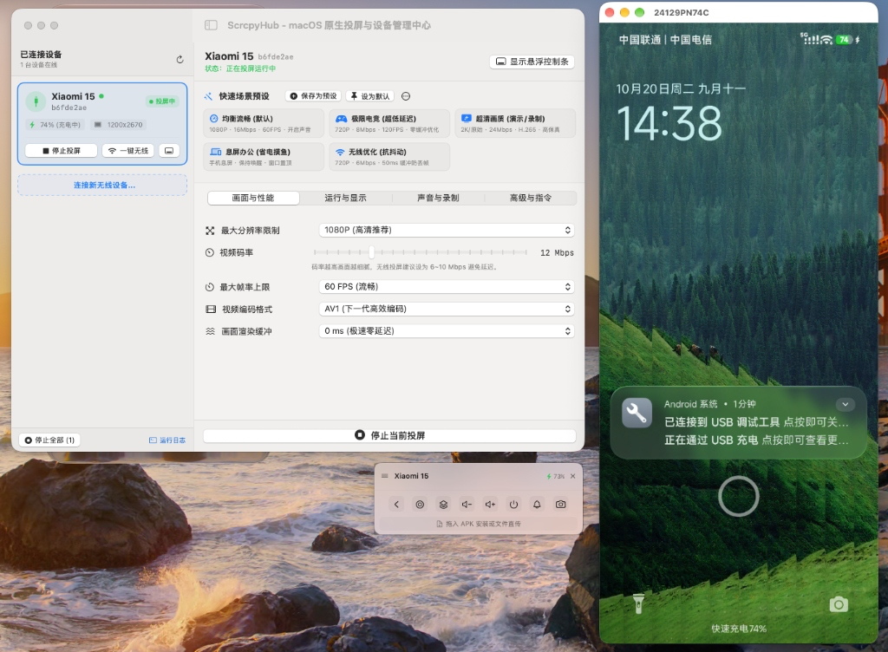

# ScrcpyHub

<p align="center">
  
</p>

<p align="center">
  <b>专为 macOS 打造的高性能原生 scrcpy 可视化投屏与多设备管理工具</b>
</p>

<p align="center">
  
  
  
  
  
</p>

<p align="center">
  <b>简体中文</b> | <a href="README_EN.md">English</a>
</p>

<p align="center">
  
</p>

---

## ✨ 功能特性

- 🍎 **纯正原生体验**：基于 SwiftUI 与 AppKit 开发，毫秒级启动、内存占用极低，完美适配深浅色外观。
- 🖥️ **双重交互形态**：
  - **主工作台**：直观管理设备池、实时显示电池与充电状态、精细调节分辨率、码率及各类高级参数。
  - **系统菜单栏常驻**：常驻屏幕顶部菜单栏，随时查看在线设备，一键快速投屏。
- 🎮 **伴随悬浮控制条 (HUD)**：
  - **按键模拟**：返回键、Home 键、多任务后台、音量调节、息屏点亮与下拉通知栏。
  - **便捷拖拽**：直接拖入 `.apk` 即可自动安装，拖入任意文件直接推送至手机下载目录。
  - **一键高清截屏**：无损截图并自动保存至 Mac「下载」目录。
- ⚡ **一键无线投屏与多设备并发**：
  - 插线状态下点击「一键无线」即可拔线使用；亦支持 Android 11+ 纯无线配对码连接。
  - 支持多台 Android 设备独立配置、并发多开投屏。
- 🎯 **场景预设与默认配置**：
  - 内置极速电竞、超清画质、息屏摸鱼等快捷预设。
  - 支持将微调好的参数保存为专属预设，或「设为默认」随用随走。
- 📦 **免配置开箱即用**：内嵌官方最新 **scrcpy 5.0.1** 与 **ADB 37.0.1** 工具集，无需手动安装 Homebrew 依赖。

---

## 📥 下载安装

前往 [**GitHub Releases**](https://github.com/1SZX1/ScrcpyHub/releases) 下载最新版 **`ScrcpyHub-macOS-arm64.dmg`**：

1. 双击打开下载好的 `.dmg` 镜像；
2. 将 **ScrcpyHub** 拖移到 **Applications**（应用程序）文件夹即可。

> **系统要求**：macOS 13.0 (Ventura) 及以上，Apple Silicon 芯片 (M1 / M2 / M3 / M4 系列)。

---

## 🚀 快速上手

1. 手机打开 **【设置 ➔ 开发者选项 ➔ USB 调试】**；
2. 使用数据线连接 Mac（或通过无线连接向导配对）；
3. 打开 ScrcpyHub，在设备列表中点击 **「立即启动投屏」** 即可。

---

## 🛠️ 从源码构建

如果您希望自行编译或进行二次开发：

```bash
# 1. 克隆本仓库
git clone https://github.com/1SZX1/ScrcpyHub.git
cd ScrcpyHub

# 2. 一键编译并生成 DMG 与 ZIP 安装包 (自动拉取工具包并编译)
./scripts/create_dmg.sh
```

生成的安装包位于 `dist/` 目录下。您也可以双击 `App/Package.swift` 直接在 **Xcode** 中进行调试。

---

## 📄 开源许可证

本项目基于 [Apache License 2.0](LICENSE) 开源。

### 致谢
- [Genymobile/scrcpy](https://github.com/Genymobile/scrcpy)：优秀的 Android 高性能投屏引擎
- [Google Android Platform Tools](https://developer.android.com/studio/releases/platform-tools)：ADB 调试桥
